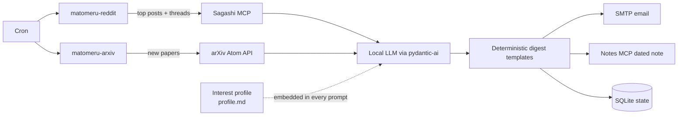

# Matomeru 📰

**Matomeru (まとめる, “to bring together / organize”) is a cron-driven, self-hostable digest generator for Reddit and arXiv.** Every day it collects the posts and papers from a rolling 24-hour window, summarizes them against your personal Markdown interest profile using a local LLM, emails the result, and files one dated note per source into your notes vault. It is not a service: two standalone CLI commands, no Docker, built to be invoked by cron.

AI tools were used during development.

## 🙋 Why Matomeru?

Feed readers show you everything; Matomeru reads for you. The interest profile and the summarization prompts are yours, the LLM runs on your own hardware, and the digest lands in the two places you actually read — your inbox and your notes vault. Reddit collection goes through [Sagashi](https://github.com/divin/sagashi), a self-hosted MCP server, and notes go through your own Notes MCP server, so no third-party service sees your reading list.

## 🧭 How it works



Two sources, two commands, each with its own digest, email, and notes folder:

- `uv run matomeru-reddit` collects the configured top posts from selected subreddits, fetches their threads and top comments through the Sagashi MCP server, and summarizes each post and its discussion, explaining its relevance to the profile.
- `uv run matomeru-arxiv` queries the official arXiv Atom API for new papers in configured categories and abstract search terms, screens each abstract against the profile, and summarizes the relevant papers.

**The determinism principle.** Configuration owns everything structural: paths, folders, recipients, window boundaries, and the digest layout — templates live in code, not in the model. The LLM only fills text slots via structured output: `summary` and `why_relevant` for each Reddit thread, `summary` and `why_relevant` for each included arXiv paper, and the `include`/`reason` screening decision for arXiv papers. The agent registers no tools and never receives authority to act; prompt content is embedded purely as data with fixed truncation caps.

**Conservative exclusion.** arXiv screening prompts instruct the model to decide `include=false` when uncertain, and a screening call that *fails* (model or transport error) is also treated as excluded — a paper is left out rather than guessed into the digest. A Reddit thread whose summarization fails is likewise excluded and recorded in the digest's Errors section.

## 🚀 Quick start

Prerequisites: [uv](https://docs.astral.sh/uv/) (provides Python 3.12), a running **Sagashi MCP** server (≥ 0.3.1, streamable HTTP), a running **Notes MCP** server (streamable HTTP) exposing `create_folder` / `create_note`, a **local OpenAI-compatible LLM endpoint** with structured-output support, and an **SMTP account**.

1. Clone and install:

   ```sh
   git clone <repository-url>
   cd matomeru
   uv sync
   ```

2. Write `profile.md` — your Markdown interest profile (general interests plus per-source detail); it is embedded verbatim into every prompt.
3. Copy `example.matomeru.toml` to `matomeru.toml` and fill in your values. The `[profile] path` and `[reddit] subreddits` fields are required; see the [configuration reference](#%EF%B8%8F-configuration-reference). The file is looked up at the explicit `--config` path, the `MATOMERU_CONFIG` environment variable, or `matomeru.toml` in the current working directory, in that order.
4. Copy `example.env` to `.env` and fill in the TODO values. All variables (required and optional) are listed there; the required ones are enforced at startup.
5. Verify with a dry run — prints the computed window plan and exits 0 without touching state or the network:

   ```sh
   uv run matomeru-reddit --dry-run
   ```

   Do the same for `matomeru-arxiv` if you use it.

6. First real run:

   ```sh
   uv run matomeru-reddit
   uv run matomeru-arxiv
   ```

   Each run writes its note, sends its email, and records the run in the state database. Exit code 0 means the digest was delivered (or the run was skipped because it already completed).

Notes folders (`notes.reddit_folder` / `notes.arxiv_folder`) are created automatically on first use (`ensure_folder` is idempotent), so no manual setup is needed — though an empty folder value disables notes delivery for that source.

## ⚙️ Configuration reference

### `.env` variables

All variables are loaded from `.env` in the working directory (via `python-dotenv`) or the environment. Missing *required* variables raise a `ConfigError` and the run exits 1.

| Variable | Required | Default | Meaning |
| --- | --- | --- | --- |
| `SAGASHI_MCP_URL` | required | — | Base URL of the Sagashi MCP server (streamable HTTP). |
| `SAGASHI_MCP_TOKEN` | optional | none | Bearer token sent as `Authorization: Bearer …` to Sagashi. |
| `NOTES_MCP_URL` | required | — | Base URL of the Notes MCP server (streamable HTTP). |
| `NOTES_MCP_TOKEN` | optional | none | Bearer token for the Notes MCP server. |
| `LLM_BASE_URL` | required | — | Base URL of the OpenAI-compatible endpoint (chat completions with structured output). |
| `LLM_API_KEY` | optional | `"local"` | API key for the endpoint; local endpoints typically ignore it, but it must be non-empty for the OpenAI client, so Matomeru defaults to `local`. |
| `LLM_MODEL` | required | — | Model name passed to the endpoint. |
| `SMTP_HOST` | required | — | SMTP server hostname. |
| `SMTP_PORT` | required | — | SMTP port (integer, 1–65535). Port `465` uses implicit TLS; any other port uses STARTTLS when the server offers it, plain otherwise. |
| `SMTP_USER` | optional | empty | SMTP username; login only happens when a username is set. |
| `SMTP_PASSWORD` | optional | empty | SMTP password (never logged). |
| `SMTP_FROM` | required | — | Sender address (`From` header and envelope sender). |
| `SMTP_TO` | required | — | Comma-separated recipient addresses. |
| `TZ` | required | — | IANA timezone name (e.g. `Europe/Berlin`) used for the report date and local display. |
| `MATOMERU_STATE_DB` | optional | `~/.local/state/matomeru/state.sqlite3` | Path to the SQLite state database. |
| `MATOMERU_LOG_LEVEL` | optional | `INFO` | Log level (`DEBUG`, `INFO`, `WARNING`, `ERROR`, `CRITICAL`); invalid values fall back to `INFO` with a warning. |

### `matomeru.toml`

| Section | Key | Required | Default | Meaning |
| --- | --- | --- | --- | --- |
| `[profile]` | `path` | required | — | Path to the Markdown interest profile. |
| `[reddit]` | `subreddits` | required | — | List of subreddits to monitor (at least one). |
| `[reddit]` | `posts_per_subreddit` | optional | `3` | Number of top posts collected per subreddit. |
| `[reddit]` | `comments_per_post` | optional | `20` | Number of top comments fetched per post. |
| `[arxiv]` | `categories` | optional | `[]` | arXiv categories such as `"cs.AI"`; at least one category or search term must be set. |
| `[arxiv]` | `search_terms` | optional | `[]` | Abstract search terms (quoted phrases); fallback selector for categories without a `category_terms` entry; at least one category or search term must be set. |
| `[arxiv]` | `category_terms` | optional | `{}` | Per-category search-term overrides (`category = ["term", ...]`); an explicitly empty list keeps all papers of that category; keys without a matching category are inert. |
| `[arxiv]` | `max_results` | optional | `100` | Maximum results requested from the arXiv API per run (positive integer). |
| `[notes]` | `reddit_folder` | optional | empty | Vault folder for Reddit notes; empty disables notes delivery for Reddit. |
| `[notes]` | `arxiv_folder` | optional | empty | Vault folder for arXiv notes; empty disables notes delivery for arXiv. |

Notes on the arXiv section:

- Both `categories` and `search_terms` empty is a **`ConfigError`** — retrieval needs at least one selector. The two combine as `(categories) AND (search terms)` when both are present.
- `max_results` must be a positive integer or the run exits 1 with a `ConfigError`.

## ⏰ Cron setup

Run each command from cron, logging output to files:

```cron
# m  h  dom mon dow  command
30 7  *   *   *   cd /opt/matomeru && uv run matomeru-reddit >> /var/log/matomeru/reddit.log 2>&1
45 7  *   *   *   cd /opt/matomeru && uv run matomeru-arxiv  >> /var/log/matomeru/arxiv.log 2>&1
```

Timezone notes:

- **cron uses the server's timezone** — setting `TZ` in `.env` labels the report date but does not change *when* cron starts the command. Align the server's cron timezone with `TZ` in `.env` (e.g. run both from a server whose timezone matches).
- The run window is a rolling 24 hours computed on UTC instants, independent of the run hour. Around a daylight-saving transition, two consecutive daily runs at the same local time are 23 or 25 elapsed hours apart, so the rolling window can briefly overlap the previous window or leave a one-hour gap. This is an accepted trade-off; items that straddle the boundary may appear twice or once.
- Each daily run is keyed by the local report date: if the previous run completed, it is skipped (see below). Use `--force` to reprocess.

## 🔁 Operations

### State database

- Location: `MATOMERU_STATE_DB`, default `~/.local/state/matomeru/state.sqlite3`. Not a service or container; it is created automatically with parent directories.
- Backup: stop nothing — the file is only touched during runs; copy it like any other SQLite file (`sqlite3 <path> ".backup backup.sqlite3"` or `cp` between runs).
- Reset: delete the SQLite file (and its `-wal`/`-shm` siblings if present). The next run treats every run as new — **completed runs are re-run**, which re-sends the email and overwrites the notes (notes are upserted by path, so no duplicates).

### Rerun semantics

- Each run is keyed by `(source, report_date)` where `report_date` is the local date in `TZ` when the run starts.
- A **completed** run is skipped on the next invocation (exit 0, nothing touched).
- `--force` restarts even a completed run: the saved 24-hour window is reprocessed with fresh LLM calls, the note is overwritten at the same path, and the email is **sent again**.
- Running/failed rows are always restartable with or without `--force`; state updates after the run starts are best-effort and never block delivery.
- **SMTP exactly-once caveat:** the email is sent before the `email_sent` delivery flag is recorded. If the process crashes between the server accepting the message and the state record, the rerun will send a duplicate. Delivery is therefore *at-least-once* for email.

### Exit codes

- `0` — the digest was delivered, the run was skipped (already completed), or it was a `--dry-run`.
- `1` — configuration error (`ConfigError`, e.g. missing required env vars, bad TOML, empty arXiv selectors, invalid timezone) or an incomplete run (partial content, failed collection, or a failed destination).

### Logging

- Output goes to **stderr** in a cron-friendly format (`timestamp LEVEL name message`); redirect `2>&1` into your cron log files.
- `MATOMERU_LOG_LEVEL` controls verbosity. Credentials and passwords are never logged.

### Partial runs

- The digest always renders — even an empty window produces a "no results" digest that is delivered normally and marked complete.
- Item-level failures (a Reddit thread or arXiv paper that could not be summarized) are excluded from the digest but listed in its **Errors** section, and the run exits 1 (it was still delivered — the exit code tells you content is incomplete).
- arXiv screening failures do *not* mark the run partial (the paper is conservatively excluded), but they appear in the Errors section.
- Destination failures are isolated: an email failure never prevents the note (and vice versa), but any failed destination makes the run exit 1 so the next cron invocation retries it.

## 🧪 Development

Use Python 3.12 and [`uv`](https://docs.astral.sh/uv/):

```sh
uv sync --dev
uv run ruff format src tests
uv run ruff check src tests
uv run ty check .
uv run pytest tests -q
```

The test suite currently contains **192 tests** and passes.

## 📚 Documentation

- [Implementation plan and decisions](PLAN.md)
- [Configuration sample](example.matomeru.toml)
- [Environment variable template](example.env)
- [Reddit rate-limit research](docs/research/reddit-rate-limits.md)
